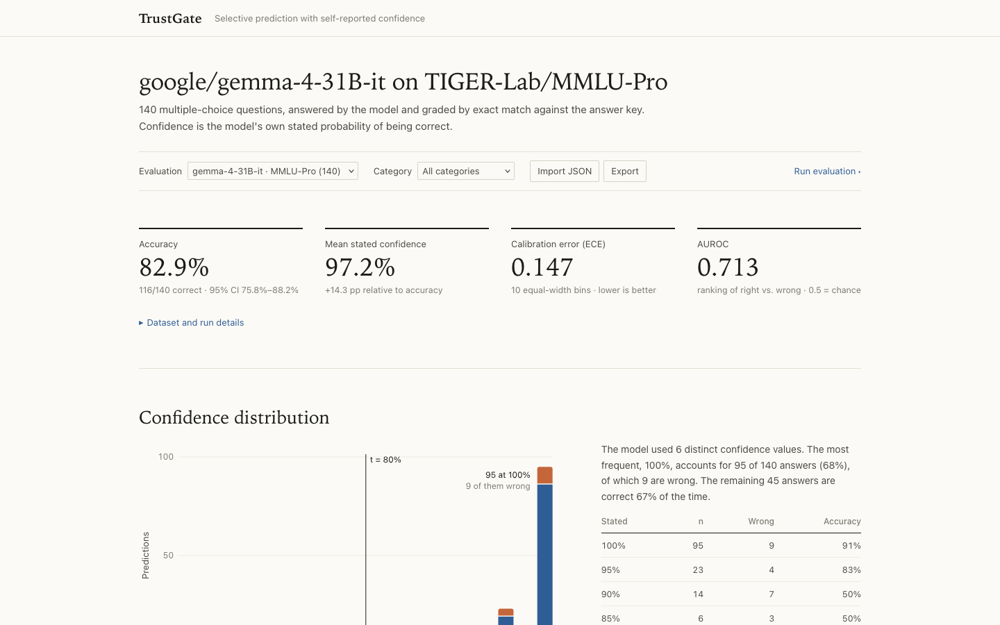

# TrustGate

A small, local tool for evaluating **selective prediction** with LLMs: given a model's answers and its self-reported confidence, when should a system answer, and when is deferring to a human cheaper than risking an error?

TrustGate measures calibration (ECE, Brier, reliability diagram), how well confidence ranks right above wrong answers (AUROC), the risk–coverage trade-off, and the cost of threshold policies. It validates a threshold on held-out questions.



## Quick start

Requires Python 3.10+ and a browser. There are no third-party dependencies. Viewing the shipped evaluation or imported results needs no API key.

```bash
python3 app.py            # http://127.0.0.1:8000  (--port 8080 if busy)
python3 -m unittest discover -s tests -v
```

The dashboard opens on the saved real evaluation in `evaluations/`. Without one it shows an empty state with instructions; it never fabricates predictions. The page reads top to bottom: headline metrics, then *Confidence distribution*, *Calibration*, *Selective prediction* (threshold and cost controls), *Held-out evaluation* and the *Predictions* table. **Evaluation** switches between saved runs, **Category** filters every figure and metric, *Import JSON* loads other result files, and *Run evaluation* queries a configured model (disabled, with a setup hint, when no provider is configured).

## Results: Gemma on an MMLU-Pro sample

One run of `google/gemma-4-31B-it` (temperature 0, `max_tokens` 4096, prompt `mcq-v2`) on the 140-question sample described below. Of the 140 replies, 140 were parsed, 0 were unparseable and 0 requests failed. The published result in `evaluations/` contains each question, the predicted letter and the stated confidence; full model responses are kept locally and not published.

| Metric | Value |
|---|---|
| Accuracy | 82.9% (116/140; 95% Wilson interval 75.8–88.2%) |
| Mean stated confidence | 97.2% (+14.3 pp above accuracy) |
| ECE (10 bins) / Brier | 0.147 / 0.153 |
| AUROC | 0.713 |

What the run shows:
- **The model is overconfident, and its confidence is coarse.** It stated only six distinct values (70–100). 95 of 140 answers claim 100%, and 9 of those are wrong (9.5%). Answers below 100% are correct only 67% of the time.
- **Confidence ranks, but is poorly calibrated.** An AUROC of 0.71 means higher stated confidence does go with correctness. Read as probability estimates, however, the stated values are systematically too high.
- **Accuracy varies by category** (n = 10 each): law 4/10, philosophy 6/10, engineering and history 7/10; chemistry, economics and physics 10/10.
- **The threshold does not transfer to the held-out half.** With a wrong answer costing 10 and a deferral costing 1, a threshold of 95% fitted on the calibration half (90% accuracy there) has 6.3% selective risk. On the test half (76% accuracy) the same threshold gives 16.4% risk and costs 105, against 170 for answering everything and 70 for deferring everything. At this cost ratio, stated confidence was not a reliable enough signal to beat deferring everything out of sample.
- **The retrospective optimum looks better than it is.** On all 140 questions it is "answer only at 100%" (cost 135). That number was fitted to the same data it is reported on.

These are single-run, small-sample observations, not general claims about Gemma.

## Benchmark data

**MMLU-Pro sample (main benchmark).** [TIGER-Lab/MMLU-Pro](https://huggingface.co/datasets/TIGER-Lab/MMLU-Pro) ([paper](https://arxiv.org/abs/2406.01574)), `test` split, revision `b189ec765aa7ed75c8acfea42df31fdae71f97be`, MIT license. MMLU-Pro combines filtered MMLU questions with STEM-website, TheoremQA and SciBench problems. It has up to 10 options (A–J), and the sample includes items with 4, 7, 8, 9 and 10 options.

Sampling (`fetch_mmlu_pro.py`, fixed before any model was run):
- For each of the 14 categories in alphabetical order, the category's test questions are sorted by `question_id`, and 10 are drawn with one shared `random.Random(42)` (`rng.sample`). That gives 140 questions.
- Within each category, the first 5 drawn questions form the **calibration** half and the other 5 the **test** half (70/70, stratified).
- No question is selected or removed based on model performance.
- `cot_content` (worked explanations) and `answer_index` are not stored. The answer letter is kept for grading only and never sent to the model.

The sample is committed as `data/mmlu_pro_sample.json` together with its source metadata; license and attribution are in `THIRD_PARTY_NOTICES.md`.

**Revision handling.** `fetch_mmlu_pro.py` uses the Hugging Face datasets-server JSON API (standard library only). That API always serves the dataset's *current* revision and cannot download an older one. The script therefore *verifies* rather than pins: it aborts unless the current revision equals the recorded `b189ec7…` before and after the download. The committed sample is the reference; regenerating from a newer revision needs `--accept-revision` and invalidates cached answers.

**Subsets.** Runs can use 14, 70 or 140 questions, i.e. 1, 5 or 10 per category (`benchmark.subset`). Within each category, calibration and test questions are taken alternately in their fixed draw order. A 70-question run therefore still has both halves (42/28) for the held-out check, and every smaller subset is contained in the larger ones.


## Evaluation methodology

**Prompt.** There is one request per question, zero-shot, using chat completions. The system prompt asks the model to reason if needed and end with `Answer: <letter>` and `Confidence: <0–100>`. The user message contains only the question and the lettered options; the answer key and explanations are never included. No structured-output or JSON-schema features are used, so any OpenAI-compatible endpoint works. Temperature is 0 by default, and `max_tokens` defaults to 4096 to leave room for reasoning.

**Parsing** (`provider.parse_prediction`):
- Text inside `<think>…</think>` is ignored.
- Formats are tried in this order: a JSON object `{"answer", "confidence"}`, then `Answer:` / `Confidence:` on their own lines (Markdown tolerated), then a lenient search in prose. The last occurrence wins.
- The letter must be one of the question's options.
- Confidence must lie in 0–100 (`%` allowed). A non-integer below 1 (e.g. `0.85`) is ambiguous between the 0–1 and 0–100 scales, so it is **rejected rather than guessed**.

**Failures are reported, never silently dropped:**
- Truncated (`finish_reason = length`) or unparseable replies are stored locally with `status: invalid` and the raw output. They are excluded from the metrics; their IDs and count (not their text) appear in published results and the dashboard. They are not re-asked, because retrying only failed items biases the sample.
- Transport errors are retried with backoff (4 attempts; not for 4xx auth/model errors). If a request still fails, it is not stored, so it is retried on the next run.

**Metrics.** For confidence $p_i$ and correctness $y_i$:
- **ECE:** 10 equal-width bins; count-weighted |accuracy − mean confidence|.
- **Brier:** mean of $(p_i - y_i)^2$.
- **AUROC:** probability that a correct answer receives higher confidence than an incorrect one (ties count ½). It is **N/A** when all answers are correct or all are wrong. With constant confidence and both outcomes present it is exactly 0.5: confidence then carries no ranking information.
- **Accuracy interval:** 95% Wilson score interval, which stays within [0, 1] and remains usable for small category subsets (n = 10).
- **Policies:** threshold $t$ accepts $p_i \ge t$. Coverage = accepted / total; selective risk = wrong accepted / accepted (undefined at zero coverage). Cost = $C_w \cdot$ wrong accepted $+ C_d \cdot$ deferred. All attainable thresholds are enumerated, including *defer all*; tied scores move together.

**Retrospective vs. validated thresholds:**
- The **retrospective optimum** is the cheapest threshold on the displayed data. It is chosen after seeing the outcomes and is optimistic.
- The **held-out check** chooses the threshold on the 70 calibration questions only and applies it unchanged to the 70 test questions. This is the only out-of-sample number. With n = 70 it is still noisy.
- The perfect-calibration break-even $1 - C_d/C_w$ is shown for reference only.

## Reproducing a run

Configuration comes from environment variables only. `.env.example` lists them with placeholders; copy it to the git-ignored `.env` or keep endpoints and keys in a private file outside the repository.

| Variable | Meaning | Default |
|---|---|---|
| `TRUSTGATE_API_BASE` | OpenAI-compatible base URL (`/chat/completions`, `/models` are appended); https required except localhost | `https://api.openai.com/v1` |
| `TRUSTGATE_MODEL` | model ID | `gpt-5.4-mini` |
| `TRUSTGATE_API_KEY` | API key (fallback `OPENAI_API_KEY`) | — |
| `TRUSTGATE_API_KEY_FILE`, `TRUSTGATE_API_KEY_NAME` | read the key from a file, plain or `NAME=value` lines | — |
| `TRUSTGATE_TEMPERATURE`, `TRUSTGATE_MAX_TOKENS` | sampling | `0`, `4096` |
| `TRUSTGATE_TIMEOUT`, `TRUSTGATE_WORKERS` | seconds per request, parallel requests (1–4) | `300`, `4` |

```bash
export TRUSTGATE_API_BASE="https://llm.example.edu/api"   # your endpoint
export TRUSTGATE_MODEL="google/gemma-…"
export TRUSTGATE_API_KEY_FILE=~/.my_keys.env TRUSTGATE_API_KEY_NAME=KEY_1

python3 evaluate_model.py --list-models     # is the model still offered?
python3 evaluate_model.py --questions 14    # 1 per category, quick check
python3 evaluate_model.py --publish         # all 140 questions → evaluations/
```

How runs are stored:
- Each answer, with its raw output, is appended to the local cache `results/mmlu-pro-<model>-<provider>.jsonl` as soon as it arrives. A later run of any size, from the command line or the dashboard, reuses stored answers and only requests missing ones. An interrupted run resumes where it stopped.
- **Cache identity.** Answers are reused only if model ID, provider, temperature, max_tokens, prompt version, dataset revision and a hash of the sample file all match. The provider is identified by a short hash of the base URL (`<provider>` in the file name), so the same model ID served by two providers never shares answers, and the endpoint itself is never written. A mismatch stops the run with the differing fields named.
- `results/` is git-ignored and holds everything provider-specific.
- `--publish` writes only the sanitized dashboard JSON to `evaluations/`: questions, predicted letters, confidence, correctness, run settings and dataset metadata. Raw responses, the provider hash, endpoints and keys are never published, including for unparseable answers.
- Provider error messages are reduced to the HTTP status plus a short message with URLs, host names, e-mail addresses, keys and long tokens removed.
- In the dashboard, *Run evaluation* first reports how many answers are cached and how many requests will be sent, and asks for confirmation before any new request. Results label each prediction as *cached* or *newly generated*.

Results are not bit-reproducible on a shared inference server, even at temperature 0. The run file records what was actually returned.

## Architecture

```
benchmark.py       MMLU-Pro sample loader and per-category subsets
fetch_mmlu_pro.py  one-off download + seeded, stratified sampling
provider.py        OpenAI-compatible client, answer parsing, resumable JSONL runs
evaluate_model.py  command-line evaluation
engine.py          metrics, policy enumeration, held-out threshold check
app.py             local HTTP server (127.0.0.1 only)
static/            dashboard: plain HTML/CSS/JS, hand-written SVG charts
tests/             metrics edge cases, parsing, configuration, runs, server, secret handling (no network);
                   synthetic records exist only here, in tests/fixtures.py
evaluations/       published, sanitized runs (JSON for the dashboard)
```

## Limitations

- **Sample size.** 140 questions (10 per category, 70 for the held-out test) give wide intervals. Per-category numbers (n = 10) are anecdotal.
- **Self-reported confidence** is one elicitation method, with one prompt. Token probabilities, sampling consistency or other prompts can behave very differently.
- **Grading** is exact match on the option letter against the MMLU-Pro key. The dataset authors note that the key contains some errors.
- **Contamination.** MMLU-Pro is public, so a model may have seen questions during training.
- **One model, one run, one temperature.** No comparative claims.
- **Deferral** is a fixed cost; the quality of human review is not modelled.
- TrustGate is an educational prototype designed for localhost. It is not a production safety layer.

## Licensing and terms

- TrustGate source code: MIT, see `LICENSE`.
- MMLU-Pro sample: MIT per the dataset card, copyright TIGER-Lab; details and caveats in `THIRD_PARTY_NOTICES.md`.
- Gemma predictions in `evaluations/` are subject to the [Gemma Terms of Use](https://ai.google.dev/gemma/terms). Check that your inference provider permits publishing model outputs before committing them.

## Development

Developed with the assistance of AI coding tools, with human review of the evaluation methodology, implementation, and experimental results.
